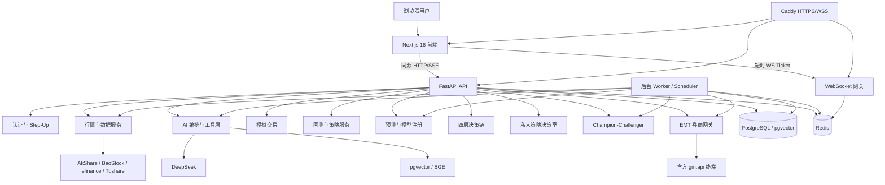
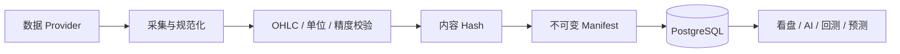
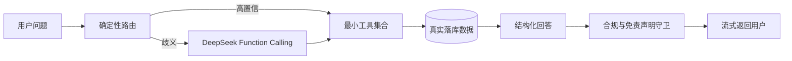
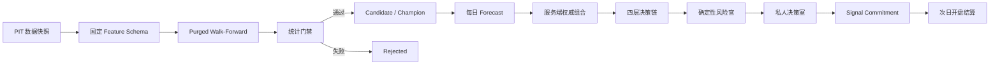

# AI 原生 A 股投研平台：已实现功能与整体架构

## 1. 文档信息

| 项目 | 内容 |
|---|---|
| 文档性质 | 当前实现基线与系统架构说明 |
| 对应版本 | `v1.17.0` |
| 对应分支 | `dev` |
| 对应提交 | `fcc1b91` |
| 更新日期 | 2026-10-25 |
| 适用范围 | 当前仓库中已经实现、测试或明确受限的能力 |
| 总体规格 | `SPEC.md` |

本文档描述系统当前已经具备的功能、模块边界、关键数据流、信任边界、运行约束和未完成事项。
本文不把“已有接口骨架”“等待外部验收”或“规划中的能力”描述为已经可用的生产功能。

---

## 2. 系统定位

本项目是面向个人投资者和研究者的 AI 原生 A 股投研平台，覆盖：

1. 行情查看与数据管理；
2. AI 看盘问答；
3. 盘前早报和深度研究；
4. 模拟交易；
5. 策略管理与严谨回测；
6. 机器学习预测和模型注册；
7. 服务端权威组合构建；
8. 多 Agent 对抗式决策；
9. 私人策略决策室；
10. Champion–Challenger 前向模拟；
11. 官方东财/掘金终端接入准备；
12. 全链路审计、认证、通知和工程化部署。

当前系统定位仍是“研究、模拟和审计平台”，不是已开放的自动实盘交易系统。

---

## 3. 总体状态

### 3.1 已完成的主阶段

| 阶段 | 状态 | 核心结果 |
|---|---|---|
| Phase 0 | 已完成 | FastAPI、PostgreSQL、Redis、数据源抽象、认证、WebSocket、前端壳 |
| Phase 1 | 已完成 | 看盘、自选股、个股详情、AI 看盘问答、选股 |
| Phase 2 | 已完成 | 盘前早报、深度研究、RAG、多智能体 |
| Phase 3 | 已完成 | A 股规则模拟交易和 AI 复盘 |
| Phase 4 | 已完成 | 原生回测、Backtrader 调度适配、策略库、网格寻优 |
| 策略进化 M1–M6 | 已完成 | 策略协议、全 A 回测、预测、决策链、决策室、模拟晋级 |
| 策略进化 M7 | 基础完成、未验收 | 官方 `gm.api` bridge 已实现，但订单发送硬关闭 |
| 策略进化 M8 | 未实现 | 小资金实盘未开放 |

### 3.2 当前明确结论

- 当前没有可信 Champion 模型；
- 所有预测候选均未达到统计晋级门槛；
- 公开 AI 问答不能代替用户作最终买卖决定；
- 决策链不会直接创建订单；
- 策略决策室的 `executionEnabled` 仍为 `false`；
- 东财 bridge 不会调用 `order_volume`；
- 小资金实盘未开放；
- 实际模型微调尚未执行。

---

## 4. 总体架构

### 4.1 前端

- Next.js 16；
- React 19；
- TypeScript；
- shadcn/ui；
- Tailwind CSS；
- ECharts 按需加载；
- React Query；
- Zustand；
- Vitest；
- Playwright；
- HttpOnly Cookie 会话；
- 同源 API 代理；
- WebSocket 客户端自动重连。

### 4.2 后端

- Python；
- FastAPI；
- SQLAlchemy；
- Alembic；
- PostgreSQL；
- pgvector；
- Redis；
- APScheduler；
- DeepSeek；
- LangGraph；
- LightGBM；
- XGBoost；
- Backtrader。

### 4.3 进程职责

| 进程 | 职责 |
|---|---|
| API | HTTP、SSE、认证、业务查询、用户操作 |
| Worker | 数据任务、预测任务、通知 outbox、模拟晋级、券商 bridge 协调 |
| Scheduler | 定时早报、行情刷新、训练、推理、策略进化任务入队 |
| WebSocket | 行情广播和用户私有事件 |
| PostgreSQL | 业务状态、PIT 数据、审计链、作业状态、向量数据 |
| Redis | 缓存、Pub/Sub、配额、冷却、选主和跨进程协调 |
| Caddy | HTTPS、WSS 和同源反向代理 |

---

## 5. 核心数据流

### 5.1 市场数据流

关键原则：

- 原始价格按未复权口径保存；
- 复权因子独立保存；
- 历史回测按交易日应用后复权；
- 已有 manifest 的股票日线和复权因子禁止更新或删除；
- 数据缺失不能被静默填充；
- 停牌缺 K 线必须由独立停牌证据解释；
- PIT 股票池和过滤规则均带版本。

### 5.2 AI 工具调用流

### 5.3 预测和决策流

---

## 6. 行情与看盘功能

### 6.1 看盘工作台

页面：`/market`

已实现：

- 指数概览；
- 股票搜索；
- 全市场行情表；
- 自选股列表；
- 自选股分组；
- 自选股增删；
- 条件选股；
- 数据新鲜度展示；
- WebSocket 行情订阅；
- WebSocket 正常时停止重复 HTTP 轮询。

### 6.2 个股详情

页面：`/market/[code]`

已实现：

- 实时或延迟快照；
- 最近收盘价降级；
- 日 K；
- 5/15/30/60 分钟 K；
- MA；
- MACD；
- KDJ；
- RSI；
- BOLL；
- 资金流；
- 所属行业；
- 财务摘要；
- 龙虎榜；
- 新闻公告；
- 来源和更新时间；
- 缺失数据说明；
- 嵌入式 AI 助手。

### 6.3 实时能力边界

- 免费源只能提供其自身支持的刷新粒度；
- WebSocket 只是推送机制，不会把延迟快照变成 Level-2；
- 行情不可执行、过期或缺失时，交易层拒绝使用；
- 页面必须显示“快照”“可能延迟”或“数据缺失”等状态。

---

## 7. 数据 Provider 与 PIT 数据底座

### 7.1 Provider

| Provider | 主要用途 |
|---|---|
| AkShare | 覆盖较广的市场、资金流和公开数据 |
| BaoStock | 历史 K 线、财务、历史 ST 状态 |
| efinance | 实时或准实时快照补充 |
| Tushare Pro | 全市场历史引导、状态、停牌、行业、资金流、估值 |

所有 Provider 均通过统一抽象层访问，业务服务不直接依赖特定数据源格式。

### 7.2 当前本机数据规模

| 数据 | 数量 |
|---|---:|
| 标的 | 8,766 |
| 日线 | 6,879,351 |
| 复权因子 | 6,967,138 |
| 日级内容 manifest | 1,331 |
| PIT 股票池成员记录 | 6,922,135 |
| PIT 股票池快照 | 1,331 |
| 行业有效期记录 | 11,860 |
| 资金流记录 | 48,248 |
| `daily_basic` 估值记录 | 24,124 |
| 模型运行 | 11 |
| Champion | 0 |

日线范围：2021-04-26 至 2026-10-23。

数量属于当前本机运营数据库，不是代码层固定常量。

### 7.3 PIT 股票池

每日股票池排除：

- ST 和 *ST；
- 停牌；
- 退市整理；
- 已退市；
- 上市不足 120 个交易日；
- 日均成交额不足 5,000 万元；
- OHLC 或复权质量不完整；
- 制度或可交易性证据不足。

每个快照保存：

- 规则版本；
- 成员数量；
- 合格数量；
- 上涨和下跌数量；
- 过滤器 Hash；
- 成员 Hash；
- 计算时间。

### 7.4 行业历史

使用 SW2021 一级行业：

- `index_classify`；
- `index_member_all`；
- 纳入日期；
- 剔除日期；
- 行业代码和名称。

约束：

- 2021-12-13 以前不得作为 SW2021 特征；
- 相同行业连续区间合并；
- 不同行业区间重叠时拒绝；
- 固定内容 Hash；
- 数据库禁止修改已形成的快照；
- 模型显式绑定行业快照 ID。

组合权威层仍使用 first-observed 行业 Vintage；预测特征使用独立的有效期历史快照，两类证据不能互换。

### 7.5 历史资金流

使用 Tushare `moneyflow`：

- 主动买卖净流入；
- 小单；
- 中单；
- 大单；
- 特大单。

约束：

- 源单位“万元”精确转换为“元”；
- 官方更新时间按约 19:00 处理；
- 17:30 Signal Commitment 不能使用当日资金流；
- 特征严格滞后一交易日；
- 必须和前 20 个真实交易 bar 连续对齐；
- 缺任一天即丢弃样本；
- 固定代码池、范围、内容 Hash 和可用时点策略。

### 7.6 每日估值

使用 Tushare `daily_basic`：

- PE TTM；
- PB；
- PS TTM；
- 股息率 TTM；
- 总市值。

约束：

- 官方 15:00–17:00 更新，保守按 17:00 可用；
- 亏损导致 PE 为空时保留独立缺失标记；
- 不用零伪装成正常估值；
- 总市值从万元转换为元；
- 模型绑定估值快照 ID。

---

## 8. AI 看盘问答

页面：

- `/ai`；
- 个股详情页右侧助手。

已实现：

- DeepSeek function calling；
- SSE 流式输出；
- 高置信意图确定性路由；
- 歧义请求模型路由；
- 股票代码规范化；
- 日期和数量参数修复；
- malformed JSON 拒绝；
- 交易所冲突拒绝；
- 最小工具集合；
- 工具结果字段化回答；
- 多工具证据汇总；
- 缺失数据说明；
- 强制免责声明；
- 禁止确定性荐股。

AI 可使用的主要能力：

- 报价；
- K 线；
- 财务摘要；
- 资金流；
- 行业和板块；
- 条件选股；
- 新闻和知识检索；
- 回测；
- 网格寻优。

### 8.1 AI 评测

当前拥有 150 题黄金评测集，覆盖：

- 报价和涨跌幅；
- PE/PB；
- 资金流；
- 财务；
- 行业；
- ST、停牌和退市；
- 交易日历；
- 复权；
- 单位；
- 陈旧和缺失数据；
- 多工具问题；
- 提示注入；
- 隐性荐股；
- 回测边界。

评测输出：

- JSON；
- JUnit；
- 工具准确率；
- 数值一致性；
- 诚实性；
- 合规性；
- API 失败；
- 基线差异。

评测框架已经完成，不代表当前所有 AI 指标都已经达到发布门槛。

---

## 9. 盘前早报

页面：`/brief`

已实现：

- 全局早报；
- 用户自选股个性化早报；
- 手动流式生成；
- 定时生成；
- 历史列表；
- 详情回放；
- 数据包持久化；
- 来源和缺口说明。

数据包包含：

- 指数；
- 自选股涨跌；
- 自选股资金流；
- 龙虎榜；
- 近 48 小时新闻；
- RAG 背景；
- 明确的数据覆盖缺口。

输出结构包含：

- 1 分钟结论；
- 5 分钟重点；
- 进攻/均衡/稳健观察方案；
- 条件式计划；
- 观察名单；
- 来源；
- 复盘点；
- 免责声明。

---

## 10. 多智能体与 RAG

### 10.1 多智能体早报

LangGraph 流程：

1. 规划者；
2. 市场结构分析师；
3. 资金面分析师；
4. 消息面/RAG 分析师；
5. 海外宏观分析师；
6. 主编；
7. 质量评审官；
8. 最多一次有界修订；
9. 合规反思。

每个节点记录：

- 节点名；
- 耗时；
- 输出长度；
- 工具调用；
- 质量评分；
- 修订状态。

### 10.2 RAG

已实现：

- PostgreSQL + pgvector；
- HNSW；
- 本地 BGE 中文 embedding；
- API embedding 可插拔；
- 新闻切块；
- 历史早报切块；
- 语义检索；
- 关键词检索；
- RRF 混合排序；
- `search_knowledge` 工具；
- 数据回填。

### 10.3 深度研究

流程：

1. 规划者拆解 2–4 个子问题；
2. 子问题分别执行工具调用；
3. 主笔汇总结构化研究报告；
4. 前端展示计划、进度、证据和工具轨迹；
5. 报告持久化并可回看。

---

## 11. 会话、记忆与训练数据

已实现：

- 用户隔离的会话；
- 聊天消息；
- 会话删除；
- 有限历史上下文；
- 用户主动保存的偏好；
- 偏好增删改查；
- 偏好只影响表达，不可代替工具事实；
- 训练数据默认不授权；
- 会话级 opt-in；
- 工具轨迹脱敏；
- 用户赞/踩；
- 管理员修订和审核；
- train/validation 固定拆分；
- 数据集版本和 checksum；
- PII 和泄漏审计；
- 用户撤回；
- 数据集作废重建；
- artifact 删除 outbox。

尚未执行实际微调。开始微调前至少需要：

- 500 条批准样本；
- 每个核心任务 50 条；
- validation 100 条；
- 隐私和质量门禁全部通过。

---

## 12. 模拟交易

页面：`/sim`

已实现：

- 100 万模拟资金账户；
- 市价单；
- 限价单；
- 撤单；
- 持仓；
- 委托；
- 成交；
- 挂单冻结；
- 私有 WebSocket 成交回报；
- AI 账户复盘。

撮合规则：

- T+1；
- 100 股整手；
- 佣金万 2.5；
- 最低佣金 5 元；
- 卖出印花税；
- 历史印花税切换；
- 主板涨跌停；
- ST 5%；
- 创业板改革前后规则；
- 科创板规则；
- 北交所规则；
- 注册制上市前 5 个交易日特殊规则；
- 昨收缺失时拒绝；
- 行情陈旧时拒绝；
- 上海交易日结算；
- 上一交易日 DAY 单撤销。

---

## 13. 回测系统

页面：

- `/backtest`；
- `/backtest/new`；
- `/backtest/[id]`。

已实现：

- 原生事件驱动引擎；
- Backtrader Cerebro 调度适配；
- 日线回测；
- 5/15/30/60 分钟回测；
- 参数网格；
- 异步作业；
- 运行取消；
- worker 租约；
- 历史回看；
- 权益曲线；
- 成交记录；
- 沪深300基准；
- 超额收益；
- AI 点评。

执行语义：

- 当前 bar 生成信号；
- 下一 bar 开盘撮合；
- 禁止同 bar 前视成交；
- T+1；
- 后复权；
- 费用和税；
- 涨跌停；
- 停牌；
- 成交容量；
- 部分成交；
- 拒单；
- FIFO 盈亏统计。

指标：

- 年化收益；
- 夏普；
- 索提诺；
- 最大回撤；
- 胜率；
- 盈亏比；
- 相对基准收益。

Backtrader 适配主要用于时间轴和调度对拍，A 股撮合规则仍复用共享执行账本。

---

## 14. 策略系统

### 14.1 策略版本

- 不可变 `StrategyVersion`；
- 参数 Hash；
- 源码 Hash；
- 删除留痕；
- 回测绑定具体版本；
- 名称和描述修改不改变执行版本；
- 统一 `signal-v1`。

策略信号只能表达：

- 方向；
- 置信度；
- 理由。

策略不能直接：

- 创建真实订单；
- 修改杠杆限制；
- 修改风险阈值；
- 绕过风险官。

### 14.2 内置策略

当前覆盖：

- 双均线；
- 唐奇安突破；
- 截面动量；
- Z-Score 反转；
- RSI；
- 布林带；
- 动量；
- 价格量能多因子；
- PIT 资金流事件；
- PIT 价值质量。

### 14.3 自定义策略沙箱

- 禁止 import；
- 禁止属性访问；
- 禁止文件 I/O；
- 禁止网络；
- 独立受限进程；
- CPU 和内存限制；
- 输入输出上限；
- 固定随机种子；
- 固定协议版本。

生产接收第三方不可信源码前，仍需进一步使用 rootless container 或 microVM 等更强隔离。

---

## 15. 预测模型

### 15.1 模型能力

- LightGBM；
- XGBoost；
- 次日开盘到收盘上涨概率；
- P10/P50/P90 收益区间；
- Isotonic 概率校准；
- Purged Walk-Forward；
- Embargo；
- 牛、熊、震荡、risk-off 分状态报告；
- 日期聚类 bootstrap；
- 原生模型文件；
- manifest；
- 文件 Hash；
- 数据 Hash；
- 唯一 Champion；
- 管理员晋级审计；
- 每周训练和每日推理作业。

### 15.2 晋级门槛

必须同时满足：

- 平衡准确率至少 53%；
- 日期聚类 95% 单侧下界大于 50%；
- ECE 不高于 10%；
- 80% 区间覆盖率在 75%–85%；
- 至少三个 OOS 折；
- 至少覆盖牛、熊、震荡、risk-off；
- 每种状态满足独立日期和样本数量要求；
- 每个折和每种状态均通过。

### 15.3 Feature Schema

| Schema | 新增信息 | LightGBM | XGBoost | 结论 |
|---|---|---:|---:|---|
| `daily-pit-v2` | 技术、K 线、量能、市场状态 | 49.57% | 50.73% | rejected |
| `daily-pit-v3` | 沪深300相对收益和波动 | 50.61% | 49.93% | rejected |
| `daily-pit-v4` | 行业相对收益和宽度 | 51.64% | 51.44% | rejected |
| `daily-pit-v5` | 同日资金流 | 无效 | 无效 | 时点泄漏，已作废 |
| `daily-pit-v6` | 严格滞后一日资金流 | 51.58% | 51.02% | rejected |
| `daily-pit-v7` | PE/PB/PS、股息率、市值 | 51.44% | 51.57% | rejected |

`daily-pit-v5` 误把约 19:00 更新的资金流用于 17:30 承诺，相关模型运行已标记 `invalidated/failed`。

当前 Champion 数量为 0。

---

## 16. 服务端权威组合

权威组合只接受代码，不接受客户端提供的账户数值、价格、行业、预测或风险事实。

在同一 PostgreSQL `REPEATABLE READ` 事务中读取：

- 服务端账户；
- 服务端持仓；
- 估值日收盘价；
- PIT 行业；
- Champion Forecast；
- 沪深300；
- 市场宽度；
- 用户风险档案。

限制：

- 自有资金 20 万元；
- 融资上限 20 万元；
- 总敞口 40 万元；
- 单票不超过净资产 20%；
- 单行业不超过 30%；
- 单策略/相关策略池不超过总风险预算 25%；
- 单日预计损失不超过净资产 2%；
- 回撤 15% 警告；
- 回撤 18% 禁止开仓；
- 回撤 20% 强制降险。

输出始终包含 `executionApproved=false`。

---

## 17. 四层决策链

实际审计阶段为：

1. 研究员；
2. 反证官盲审；
3. 第一轮质询；
4. 第二轮质询；
5. 投资委员会；
6. 风险官。

关键约束：

- 反证官初始不接收研究员结论；
- 恰好两轮质询；
- 投资委员会使用确定性评分；
- 逐条记录反方意见处置；
- 未采纳意见必须说明原因；
- 风险官一票否决；
- 严重分歧显式标记；
- 事件形成前序 Hash 链；
- 运行尾 Hash 和事件数锚定；
- PostgreSQL 禁止修改或删除；
- 租约和 claim token 支持崩溃恢复；
- 相同请求幂等。

严重分歧包括：

- 方向相反；
- 收益中位数差异超过 2%；
- 仓位差异超过净资产 10%；
- 发现未来函数；
- 数据陈旧；
- 重大证据缺失；
- 委员会置信度不足 60%。

---

## 18. 私人策略决策室

页面：`/decisions`

模式：

- `research_only`；
- `manual_review`；
- `simulation_ready`。

功能：

- 六阶段证据回放；
- 风险预算；
- 严重分歧；
- 接受；
- 拒绝；
- 降权；
- 人工覆盖；
- Kill Switch；
- 私有 WebSocket；
- 飞书脱敏通知；
- 行为归因。

### 18.1 二次验证

- RFC 6238 TOTP；
- 一次性用途绑定 step-up；
- 5 分钟有效期；
- 防重放；
- 持久化暴力尝试限流；
- 一次性恢复码；
- 恢复码只能用于重置 TOTP 或删除账户；
- 重置会撤销已有令牌。

### 18.2 覆盖边界

人工覆盖只能作用于风险官已批准候选，并继续受：

- 单票限制；
- 行业限制；
- 杠杆限制；
- 预计损失限制；
- Kill Switch；
- 风险否决。

---

## 19. Champion–Challenger

已实现：

- 收盘后不可变 Signal Commitment；
- 次一交易日开盘结算；
- 禁止事后回填；
- 60 个连续交易日模拟；
- 20 个交易日影子比较；
- 相同初始现金；
- 首次无 Champion 时使用现金基线；
- T+1；
- 100 股整手；
- 1% 成交容量；
- 涨跌停；
- 10bp 滑点；
- 历史费税；
- HMAC-SHA256；
- key ID；
- 历史 keyring；
- 承诺、观察和转换链；
- 漏承诺自动降级；
- 质量破线自动降级；
- 配对单侧 95% 超额收益下界；
- 人工覆盖行为归因；
- 失败记录隔离重试。

当前没有 Champion，因此真实 60+20 观察期尚未启动。

---

## 20. EMT 券商接入

已实现：

- 官方 `gm.api` adapter；
- 终端 bridge；
- 加密账户绑定；
- 加密报备资料；
- 单 bridge 租约；
- 毫秒级 timer；
- 委托幂等 outbox；
- 数据库流控；
- 断线不盲目重发；
- `uncertain` 状态；
- 资金对账；
- 持仓对账；
- 委托对账；
- 成交对账；
- 不可变演练证据。

当前发送硬关闭，原因：

- 官方 `MODE_LIVE` 同时承载仿真和实盘；
- SDK 没有机器可验证的账户类型字段；
- `simulation_account_verified=False`；
- 演练订单进入 `blocked_account_type`；
- bridge 不调用 `order_volume`。

M7 因此是“基础完成、终端未验收”，不是可用的官方仿真交易。

---

## 21. 认证、安全与隐私

### 21.1 Web 会话

- HttpOnly access Cookie；
- HttpOnly refresh Cookie；
- Bearer 兼容脚本；
- 独立短时 WebSocket ticket；
- SSR 鉴权门；
- 登录刷新不在 JSON 中返回浏览器 token。

### 21.2 注册与密码

- 生产邮箱验证；
- pending 注册不创建正式用户；
- pending 阶段不保存密码 Hash；
- 邮件 token 只保存 SHA-256；
- 重复注册不轮换未过期 token；
- 邮箱枚举防护；
- PBKDF2；
- 旧 bcrypt 成功后迁移；
- dummy hash 恒定校验；
- 强密码规则；
- 生产强 JWT 密钥规则；
- HS256 固定。

### 21.3 限流

- 规范化邮箱 bucket；
- 客户端 IP bucket；
- PostgreSQL advisory lock；
- 多 worker 原子更新；
- 登录成功清理账户 bucket；
- 默认不信任 `X-Forwarded-For`；
- 仅可信代理 CIDR 可影响客户端 IP。

### 21.4 用户隔离

- 业务记录按 `user_id` 隔离；
- 越权读取返回 404；
- 私有 WebSocket 按用户路由；
- 敏感删除使用持久化 outbox；
- 审计保留删除后的用户 ID 快照。

---

## 22. 审计和不可变性

数据库级保护覆盖：

- 决策运行；
- 决策事件；
- 人工覆盖；
- 决策室审计；
- 模型晋级审计；
- Signal Commitment；
- Evolution Observation；
- Evolution Transition；
- 券商事件；
- Tushare 日线 manifest；
- 已认证日线；
- 已认证复权因子；
- 行业成员快照；
- 历史资金流快照；
- 每日估值快照。

不可变性不只依赖应用代码，而由 PostgreSQL trigger 和约束共同执行。

---

## 23. 作业、并发与恢复

训练、推理和长任务使用：

- 持久化作业表；
- claim token；
- lease；
- 心跳续租；
- 过期任务回收；
- PostgreSQL session advisory lock；
- 行级锁；
- 发布事务 fencing；
- 幂等版本；
- 失败重试；
- 最大尝试次数；
- 旧 worker 禁止发布。

调度器使用 Redis 选主；Redis 未配置时只允许 dev/test 进程内降级。

---

## 24. 部署和可观测

### 24.1 本地

- Docker Compose；
- PostgreSQL/pgvector；
- Redis；
- Backend；
- Frontend；
- 可选 seed profile。

### 24.2 生产基线

- Caddy HTTPS/WSS；
- 同源 API；
- API/Worker 分离；
- PostgreSQL 和 Redis 私网；
- Next.js standalone；
- 显式迁移；
- 备份验证；
- 恢复演练；
- 应用回滚；
- readiness。

### 24.3 可观测

- 后端 Sentry 可选；
- 前端 Sentry 可选；
- LangSmith 可选；
- 多智能体节点轨迹；
- 作业状态和失败原因；
- 模型 OOS 证据；
- 数据完整率；
- M6 进度；
- 通知投递状态。

---

## 25. 测试与质量基线

当前验证结果：

| 类型 | 结果 |
|---|---|
| 后端 Pytest | 717 passed，2 skipped |
| 前端 Vitest | 83 passed |
| Ruff | 通过 |
| ESLint | 通过 |
| Next.js production build | 通过 |
| Docker backend build | 通过 |
| Alembic schema check | 通过 |

CI 包含：

- Ruff；
- Pytest；
- pgvector 服务；
- Vitest；
- ESLint；
- Next.js build；
- Playwright E2E；
- 无 LLM 的确定性冒烟测试。

---

## 26. 当前未完成和禁止项

### 26.1 尚未完成

1. 实际模型微调；
2. 达标 Champion；
3. 真实 60+20 Champion–Challenger 观察期；
4. 官方 EMT 仿真终端验收；
5. M8 小资金实盘；
6. 完整商业化 RBAC；
7. 多市场；
8. 完整 i18n；
9. Level-2；
10. 移动端 App。

### 26.2 明确禁止

- 客户端提交权威账户或风险数值；
- Agent 修改风险阈值；
- Agent 绕过 Kill Switch；
- 未验证账户类型时发送券商订单；
- 用当前行业分类倒填历史；
- 跨缺失交易日拼接标签；
- 使用 17:30 后才发布的数据生成 17:30 承诺；
- 为通过门槛而进行结果导向调参；
- 将 rejected 模型晋级为 Champion；
- 事后补写 Signal Commitment。

---

## 27. 关键代码目录

| 目录 | 职责 |
|---|---|
| `frontend/src/app` | 页面和路由 |
| `frontend/src/lib/api` | API 客户端 |
| `frontend/src/lib/ws` | WebSocket 客户端 |
| `backend/app/api` | FastAPI 路由 |
| `backend/app/models` | ORM 模型 |
| `backend/app/providers` | 数据 Provider |
| `backend/app/services` | 业务服务 |
| `backend/app/prediction` | 特征、模型、评估、时序切分 |
| `backend/app/backtest` | 回测和数据加载 |
| `backend/app/decision` | 决策协议 |
| `backend/app/agents` | 多智能体编排 |
| `backend/app/broker` | EMT bridge |
| `backend/app/ws` | WebSocket |
| `backend/alembic/versions` | 数据库迁移 |
| `backend/scripts` | 数据引导和评测脚本 |
| `backend/tests` | 后端测试 |
| `docs` | 架构和运营文档 |

---

## 28. 当前系统成熟度判断

### 已具备

- 日常看盘能力；
- AI 查询和研究能力；
- 可审计的市场数据；
- 严谨回测；
- 内部模拟交易；
- 策略版本和沙箱；
- 预测模型注册和统计门禁；
- 多 Agent 决策和风险控制；
- 私人决策室；
- 前向模拟晋级机制；
- 券商适配基础；
- 安全、审计和部署基线。

### 当前主要瓶颈

1. 固定 20 股训练池限制了横截面样本规模；
2. 短周期次日方向预测尚未显示稳定统计优势；
3. 没有 Champion，后续观察期无法正式启动；
4. 官方券商 SDK 无法机器验证账户类型；
5. 实际微调样本尚未达到质量门槛。

### 精确结论

当前项目已经形成：

> 数据采集与 PIT 固化 → AI 研究 → 策略回测 → 模型评估 → 权威组合 → 对抗式决策 →
> 确定性风控 → 私人复核 → 前向模拟 → 行为归因 → 全链路审计

这一完整技术闭环。

当前缺少的不是基础页面或核心架构，而是：

- 能通过严格 OOS 统计门槛的预测模型；
- 足够大的、预声明的横截面训练池；
- 官方仿真账户的可验证证明；
- 满足门禁后的长期前向运行证据。
